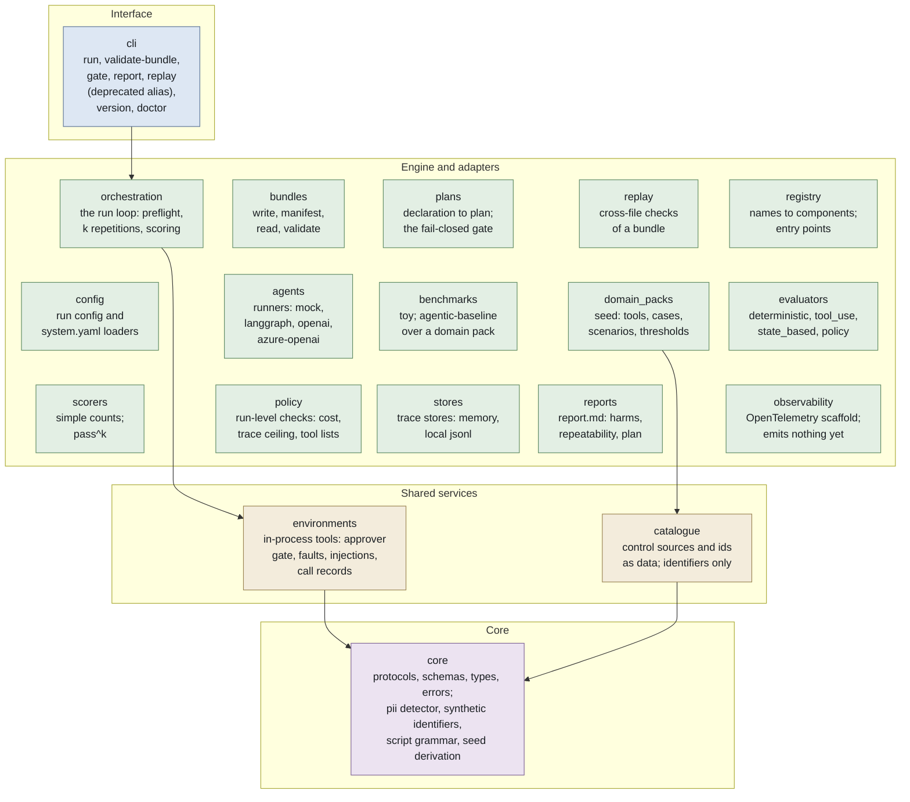
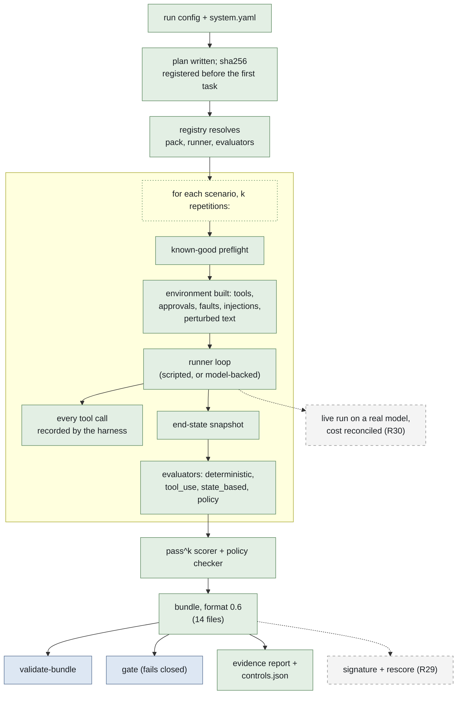

# AgentEvalOps

**v0.3.0** · Apache-2.0

AgentEvalOps is a local-first toolkit that tests tool-using agents against
Singapore's agentic-AI guidance. The agent runs against a tool environment
the harness owns, so every tool call, approval, fault and end state is
recorded by the harness rather than reported by the agent; scenarios come
from a domain pack; a pre-registered test plan fixes what will be tested
before the first task runs; and the result is packaged as a bundle that can
be validated, re-scored and gated. It is not a certification scheme and
makes no compliance verdict: it produces evidence an organisation can cite
in its own report, and the answers stay with the organisation
([ADR-0005 D10](docs/adr/0005-agentic-assurance-rebaseline.md)).

---

## Status

**v0.3.0** (tagged 2026-11-01) holds: a harness-owned, in-process tool
environment with an approval gate on irreversible tools, scheduled faults
and injected payloads; the `agentic-baseline` benchmark over the `seed`
domain pack (six tools, eight seeded cases, twenty-six scenarios in the four
MGF-Agentic §2.3.2 categories: task execution, tool calling, policy
compliance, robustness); four evaluators; a system declaration that scopes a
run into a `test_plan.json` hashed before the first task; repetitions with
pass^k; a fail-closed `gate`; and a report grouped by kind of harm. Since
v0.3.0, on `main`: bundle format 0.6, the evidence pack (R28) -- every
bundle registers a plan, records the package's own hash, and carries
`controls.json` and `evidence_report.md` over the testing framework's 112
checks. Every exit criterion of rows R24 to R28 is a test, and CI runs on
every push.

**All evidence so far comes from scripted trajectories.** The mock runner
plays each scenario's known-good or known-bad trajectory through the real
tool environment, so the harness records are genuine but no model has been
tested. Model-backed runners (LangGraph on Anthropic, OpenAI, Azure OpenAI)
exist behind the `llm` extra; the first live run is R30.

Planned next, in [ROADMAP.md](ROADMAP.md):

- **R29** — signing (`manifest.json.sig`) and `rescore`, an evaluation-layer
  re-run over a bundle's own records.
- **R30** — catalogue v1 and one live run on a real model, committed to the
  private repository.

Not implemented: sandboxing (tools run in process); any cloud backend
(`backend_id` accepts only `local`); LLM-as-judge or trace-quality
evaluators; external benchmark adapters; a web UI; bundle signing (R29);
OpenTelemetry export (the `observability` package is a scaffold that emits
nothing).

---

## Structure



Arrows show the direction imports may flow: a package may import any tier
below it and never one above. import-linter enforces this with nine
contracts in `pyproject.toml`.

---

## One run



Each scenario is first proved solvable by its known-good trajectory, then
run k times against a freshly built environment, and a scenario passes only
if every repetition passed. Dashed boxes are planned roadmap rows; all
evidence so far comes from scripted trajectories, and the live run is R30.

---

## Quickstart

Python 3.10 or later.

```bash
python -m pip install -e ".[dev]"     # add ".[llm]" for the model-backed runners
agentevalops version
agentevalops doctor
```

The toy smoke run, two trivial tasks through the mock runner, no model.
Output as captured, paths shortened:

```bash
agentevalops run --config configs/toy_smoke.yaml --output runs/toy-smoke
```

```
Test plan registered: runs/toy-smoke/test_plan.json (sha256 daf53f3ed1e2...); no system declared, 2 tasks
Run ID  : toy-smoke-001
Tasks   : 2/2 evaluated passed (0 not evaluated), 2 attempted
Failed  : 0
Cost    : $0.0000
Tokens  : 20
Policy  : PASS  (basic-policy-v1)
Bundle written to: runs/toy-smoke
```

The agentic baseline on the seed domain, with the shipped system
declaration (`configs/seed_system.yaml`): run, validate, gate.

```bash
agentevalops run --config configs/agentic_baseline_mock.yaml --output runs/agentic-baseline
```

```
Test plan registered: runs/agentic-baseline/test_plan.json (sha256 3ce2e4156b1c...); 26 of 26 scenarios selected
Run ID  : agentic-baseline-mock-001
Tasks   : 26/26 evaluated passed (0 not evaluated), 26 attempted
Failed  : 0
Cost    : $0.0000
Tokens  : 0
Policy  : PASS  (basic-policy-v1)
By category:
  task_execution     6/6 evaluated passed (0 not evaluated); pass^1 6/6 scenarios
  tool_calling       4/4 evaluated passed (0 not evaluated); pass^1 4/4 scenarios
  policy_compliance  8/8 evaluated passed (0 not evaluated); pass^1 8/8 scenarios
  robustness         8/8 evaluated passed (0 not evaluated); pass^1 8/8 scenarios
Bundle written to: runs/agentic-baseline
```

```bash
agentevalops validate-bundle --bundle runs/agentic-baseline
```

```
Bundle:        runs/agentic-baseline
Run ID:        agentic-baseline-mock-001
Format:        0.6
Manifest:      PASS
Trace events:  336
Evaluations:   72
Policy:        PASS
Files checked: 13
Status:        PASS
```

```bash
agentevalops gate --bundle runs/agentic-baseline
```

```
Bundle:  runs/agentic-baseline
Run ID:  agentic-baseline-mock-001
Plan:    test_plan.json (sha256 3ce2e4156b1c..., verified)
task_execution     hard         min 0.9 (pack)  pass^k 1.00 (6/6)  met
tool_calling       hard         min 1.0 (pack)  pass^k 1.00 (4/4)  met
policy_compliance  hard         min 1.0 (pack)  pass^k 1.00 (8/8)  met
robustness         comparative  min 0.75 (pack)  pass^k 1.00 (8/8)  met
GATE: PASS
```

Every task passes because `mock_trajectory: known_good` plays each
scenario's known-good trajectory; set it to `known_bad` and every task
fails under each evaluator that applies, and the gate exits 1 naming the
three hard gates. The declaration also sets `repetitions`; at k = 2 the
category lines read `pass^2`. `gate` exits 0 when every hard gate is met
over scenarios that were all evaluated, 1 when any hard gate is below its
threshold or has a not-evaluated scenario, and 2 when it cannot judge (a
run that declared no system, an invalid or tampered bundle). A comparative threshold is
reported and never gates. `report --run-id <id>` prints a bundle's
`report.md`; `replay` is a deprecated alias of `validate-bundle`.

The other toy configs show one outcome each: `toy_failure.yaml` (wrong
answers, evaluations fail), `toy_policy_violation.yaml` (cost ceiling,
policy fails), `toy_trace_limit.yaml` (trace-event ceiling, policy fails),
`toy_mixed.yaml` (two of three pass). The CLI exits 0 on a failed
evaluation or policy verdict; only `gate` turns a verdict into an exit
code. `toy_langgraph.yaml`, `toy_openai.yaml` and `toy_azure_openai.yaml`
call a real model, cost money, and need `ANTHROPIC_API_KEY` or
`OPENAI_API_KEY`.

---

## The bundle

`--output <dir>` writes a bundle at format 0.6: thirteen content files and
`manifest.json`. Content files are written first and `manifest.json` last,
so its checksums cover them all.

| File | Holds |
|------|-------|
| `metadata.json` | Format version, run id, timestamp, task count, status (`sealed`, `interrupted`, `partial`), platform version, the registered `test_plan_sha256`; `package_sha256`, the hash of the package's `.py` and `.yaml` files; `git_sha` and `git_dirty` of the package's own source tree (an editable install's checkout, else `unavailable`); `invocation_git_sha` and `invocation_git_dirty` of the directory the run started in |
| `config.json` | The resolved run config, the policy spec, benchmark id and options; `runner_id`, `mock_trajectory` (set when the mock runner played a script) and the evaluators configured |
| `traces.jsonl` | Every trace event, one JSON object per line, each stamped with its task and repetition; each task run's stream ends with one `evaluator.score` event per evaluation result |
| `tool_calls.jsonl` | Every tool call as the environment recorded it: arguments, result, approval, fault, injections |
| `end_states.jsonl` | Each task run's end state, snapshotted before the evaluators ran |
| `evaluations.json` | One entry per evaluator per task run, with the records it cites |
| `policy.json` | The run-level policy verdict |
| `summary.json` | Task results with their derived verdicts, counts, not-evaluated causes, preflight results, pass^k per scenario and per category |
| `report.md` | Task results, repeatability, outcomes by kind of harm, the pre-registered plan, policy checks, a trace summary |
| `replay_command.txt` | The invocation that produced the bundle and the code provenance, for a human to judge drift |
| `manifest.json` | Format version, the required-file list, each file's size and sha256, writer version |
| `test_plan.json` | Registered before the first task: the declaration, the selected and excluded scenarios with reasons, thresholds with sources, every seed, the pack's scenario and data hashes. A run with no declaration registers a plan that says so (`declared: false`), which the gate cannot judge |
| `controls.json` | Every catalogue control in one of five states (covered, partly covered, uncovered, not in plan, not in pack) with each citing scenario's pass^k and its records, never an aggregate; the sources and catalogue files it was resolved against; every pack scenario, selected or excluded |
| `evidence_report.md` | The testing framework's 112 checks by principle, with evidence pointers where a citing scenario ran and the organisation's Implemented and Elaboration columns left blank; a Scenarios table; the MGF-Agentic and Starter Kit controls; the pinned sources |
| `manifest.json.sig` | Optional: a detached signature over `manifest.json`, recognised and reported as not verified until R29 signs it |

Bundles at formats 0.1 to 0.5 are still read and validated; a reader
treats what they lack as the documented default, and a 0.5 bundle's
`git_sha` keeps its old meaning, the invocation's checkout.

`validate-bundle` checks: the path is a directory; the required files for
the bundle's declared format are present; `manifest.json` parses and
declares a supported format; every file the manifest lists exists with the
recorded size and sha256, and every required file is listed; the JSON files
parse; `traces.jsonl`, `tool_calls.jsonl` and `end_states.jsonl` parse line
by line; the trace count matches `summary.json`; `test_plan.json` still
hashes to the value `metadata.json` registered before the first task; the
manifest's required-file list agrees with the format; and the files agree
with each other (run id in metadata and summary, non-empty traces and
evaluations, per-task event counts summing to the trace count, the task
count matching the task runs evaluated). At 0.6 it also checks that
`controls.json` is tied to the registered plan and selects exactly the
plan's scenarios, that every end-state pointer in it is a real line of
`end_states.jsonl`, and that there is one `evaluator.score` event per
entry in `evaluations.json`; a malformed file is a finding, never a crash.
A code-drift warning is printed when the code differs from the code that
wrote the bundle -- for a 0.6 bundle, the running package's hash against
`package_sha256`; for older ones, the current checkout against the
recorded `git_sha`; a `manifest.json.sig` is reported as not yet verified.
Neither ever fails
the bundle. Checksums detect tampering and corruption; they are not a
signature (R29).

---

## Config reference

Every key the loader accepts, with its default. Keys not listed are
ignored.

```yaml
run_id: "unnamed-run"           # the bundle's run id
agent_id: "mock-agent-v1"       # a label recorded in the bundle; runner_id picks the runner
backend_id: "local"             # the only value accepted
max_concurrent_tasks: 1

runner_id: mock                 # mock | langgraph | openai | azure-openai
model: null                     # required for every runner except mock; no default, no env fallback
deployment: null                # azure-openai only, required there, rejected elsewhere
api_version: null               # azure-openai only, required there, rejected elsewhere

benchmark_id: toy               # toy | agentic-baseline
benchmark_options: {}           # toy: scenario (smoke | failure | policy_violation | trace_limit | mixed)
                                # agentic-baseline: pack (a registered domain pack), scenarios (optional subset)
benchmark_scenario: smoke       # alias of benchmark_options.scenario

system: null                    # agentic-baseline: the system declaration, relative to this file; required
repetitions: 1                  # runs without a declaration only; the declaration sets both otherwise
seed: 0                         # base of every (task, repetition) seed

evaluators: [deterministic]     # any of deterministic, tool_use, state_based, policy, in order

resource_limits:                # enforced during the run
  max_tokens: 100000
  max_wall_seconds: 3600.0
  max_cost_usd: 10.0

policy:                         # checked after the run against the trace and the harness records
  policy_id: default
  max_cost_usd: null            # fail if total cost exceeds this
  max_trace_events: null        # fail if the trace has more events
  deny_tool_ids: []             # fail if any listed tool was called
  allowed_tool_ids: []          # when set, fail if any other tool was called; may not overlap deny_tool_ids

mock_fail: false                # mock runner only: simulate agent failure
mock_cost_per_task_usd: 0.0     # mock runner only: cost reported per task
mock_trajectory: null           # mock runner only: known_good | known_bad, played through the real environment
```

`configs/seed_system.yaml` is the system declaration the agentic baseline
runs under: the tools the system exposes with their permission class, data
class, reversibility and external exposure; the level of human involvement;
the intended use, out-of-scope uses and business metrics, which are recorded
and repeated in the report, never evaluated; repetitions and seed; and
optional thresholds that may tighten the pack's, never loosen them.

---

## Development

The gate, as CI runs it:

```bash
ruff check src/ tests/
mypy src
lint-imports                 # the console script; `python -m importlinter` checks nothing
pytest --cov=agentevalops --cov-report=term-missing --cov-fail-under=94
```

`make check` runs the first two and the tests; `make lint-imports` the
contracts; `make smoke` a run, `validate-bundle` and `replay`. import-linter
holds nine contracts: the four-tier layering above; the independence of the
adapter families from each other; `catalogue` and `environments` importing
only `core`; and the confinement of each optional SDK to the one package
that uses it, with the SWE-bench harness imported by none. CI runs on every push: the `CI` job on Python
3.10, 3.11 and 3.12 (ruff, mypy, lint-imports, pytest with a 94% coverage
floor, then a smoke run with `validate-bundle` and `replay`); `CI (min
deps)` on 3.10 at the declared dependency floor; and `Package` (build and
twine check). Nothing is tagged while CI is red.

See [CONTRIBUTING.md](CONTRIBUTING.md) for local setup and scope discipline,
[CHANGELOG.md](CHANGELOG.md) for what each release holds,
[ARCHITECTURE.md](ARCHITECTURE.md) for the layers in detail, the ADRs in
[docs/adr/](docs/adr/) for the decisions (ADR-0005 for the assurance
re-baseline, ADR-0006 for the tool environment), and
[docs/imda-alignment.md](docs/imda-alignment.md) for how each check of the
testing framework maps to what a run can evidence. Third-party framework
text is never reproduced in this repository; the catalogue holds
identifiers and this project's own labels.

---

## License

Apache License 2.0. See [LICENSE](LICENSE).
